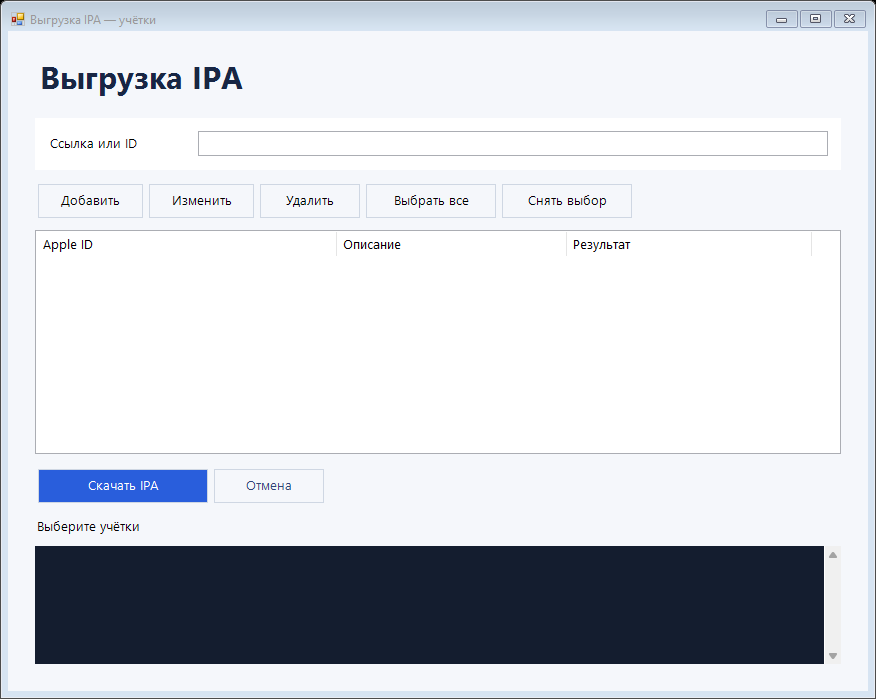

# IPA Desk Multi

Скачивайте приложения из App Store в формате IPA на Windows. Укажите ссылку или ID приложения и выберите учётные записи — программа обработает их по очереди и сохранит отдельный файл для каждой.

**[Скачать для Windows](https://github.com/TapOk38/ipa-desk-multi/releases/download/v0.3.0-beta.2/ipa-desk-multi-0.3.0-beta.2-windows.zip)** · [Все версии](https://github.com/TapOk38/ipa-desk-multi/releases) · [Сообщить об ошибке](https://github.com/TapOk38/ipa-desk-multi/issues)

## Что понадобится

- Windows x64 с Windows PowerShell 5.1.
- Интернет и Apple ID с доступом к App Store.
- Доступ к коду подтверждения, если Apple запросит двухфакторную аутентификацию.

Подключать iPhone к компьютеру или заранее устанавливать на него скачиваемое приложение не нужно.

## Как скачать IPA

1. Распакуйте ZIP целиком и запустите **Start.cmd**.
2. Нажмите **«Добавить»**, введите Apple ID, пароль и описание, по которому удобно узнавать учётку.
3. Вставьте ссылку App Store или числовой ID в поле **«Ссылка или ID»**.
4. Отметьте нужные учётки и нажмите **«Скачать IPA»**.
5. При запросе введите код подтверждения для указанной учётки.

При первом скачивании автоматически загружается необходимый компонент ipatool-cpp с GitHub. Дождитесь его подготовки.

## Файлы и учётки

IPA сохраняются в папке **Downloads** рядом с программой, отдельно для каждого приложения и Apple ID.
Имя файла содержит название, версию, минимальную iOS, Apple ID и описание учётки.

Учётки сохраняются между запусками; их можно изменять и удалять. Сохранённые пароли привязаны к пользователю Windows. При переносе на другой ПК их потребуется ввести заново.

## Перед скачиванием

Приложение должно быть доступно выбранному Apple ID. Для бесплатного приложения программа при необходимости получает лицензию; платные покупки не выполняются. Повторный запрос кода 2FA возможен.

Не рекомендуем массовую смену Apple ID и многократные повторы неудачного входа: подтверждённого безопасного количества учёток нет.

При ошибке посмотрите журнал в окне программы. Инструкция по ручной установке компонента — в [THIRD_PARTY.md](THIRD_PARTY.md). Подробности хранения учёток — в [PRIVACY.md](PRIVACY.md).

## Разработка и лицензия

[Сборка и тесты](docs/BUILDING.md) · [MIT](LICENSE).
Авторизация и скачивание выполняются через [ipatool-cpp](https://github.com/Sorvigolova/ipatool), основанный на [ipatool](https://github.com/majd/ipatool).
